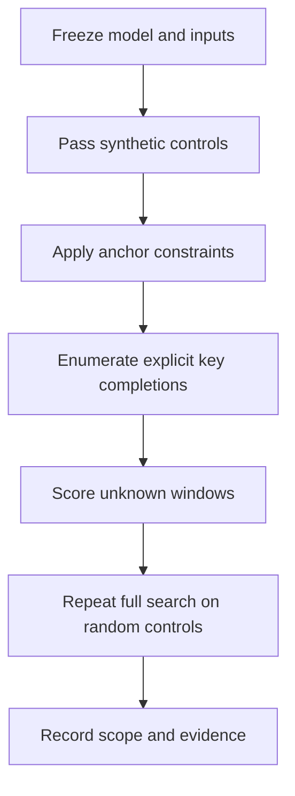

# KryptosCipher

Reproducible Kryptos research with verified K1–K3 decoders and bounded K4 experiments.
**No verified K4 plaintext or decryption method is claimed by this repository.**

The November 23, 2026 update replaces the preferred period 27 premise with explicit
model assumptions, positive controls, separately scored unknown text, and logged
search limits. Older research and exports remain available for provenance.

## Quick start

Python 3.11 or newer. The new `kryptos` package uses the standard library; the
October experiments and November algebraic audit use NumPy.

```bash
python -m pip install -e '.[test]'
python -m unittest discover -s tests -v
python -m kryptos verify
python -m kryptos diagnostics --output out/local/diagnostics.json
python -m kryptos clock --routes grids --output out/local/clock.json
python -m research.november_audit --output out/local/algebraic_audit.json
```

`python kryptos_analysis.py verify` provides the same interface after installation.
K2 exposes both the carved and corrected endings; K3 uses the verified double
rotation and preserves its physical question mark.

For a scored search, provide a legally usable quadgram count table. There is no
bundled English corpus, fabricated fallback model, or universal score cutoff.

```bash
python -m kryptos search --periods 27 --alphabet STD --mode vigenere \
  --quadgrams /path/to/english_quadgrams.txt --controls 20 --seed 20261123 \
  --output out/local/p27-calibration.json
```

This last command is a diagnostic baseline, not a preferred solution route. It
exhausts 17,576 period 27 completions per ciphertext, repeating the search on 20
histogram shuffles and 20 uniform controls. Other searches can reach explicit caps
and report `complete: false`. Without `--quadgrams`, candidate output is unscored
enumeration order, never an English ranking.

## What is established here

| Item | Current interpretation |
|---|---|
| Public anchors | EASTNORTHEAST at 22–34; BERLINCLOCK at 64–74, one based |
| Direct periodic keys | Periods 1–26 conflict under the stated STD/KRYPTOS Vigenere, Beaufort and variant Beaufort models |
| Period 27 | 24 distinct constrained residues, zero independent repeat checks, three free residues |
| Simple gap nulls | Every relative phase fails at periods 1–23 when both crib blocks remain intact under those fixed tableaux |
| Crib parity | Pairwise observation; not proof of a globally alternating key |
| Clock clue | Alexanderplatz World Clock; numeric schedules and city selections are separate hypotheses |
| Public status | Archive recovery and the official plaintext verifier do not provide a public encryption recipe |

Read the [research dossier](docs/RESEARCH_DOSSIER.md),
[hypothesis ledger](docs/HYPOTHESIS_LEDGER.json), and
[executed November runs](out/november_20261123/README.md).

## Next experiments

1. Bounded base-10 keyword Gromark with an arbitrary plaintext alphabet.
2. Independently specified alternating-parity key generators.
3. Masking and transposition that cannot reduce to a constant crib-phase change.

These are proposed, not executed. The [active roadmap](docs/ACTIVE_ROADMAP.md)
defines scope, overlap with earlier work, controls and stopping rules.

## Research contract



- Collision counts describe evidence strength. They do not reject a consistent model.
- Scores report 64 unknown-only, 12 boundary, 18 anchor-internal and 94 full-text
  windows. Missing key values are never silently filled.
- `--evaluation-holdout` fits EASTNORTHEAST and reports BERLINCLOCK recovery
  afterward. Both public blocks influenced research; this is not a pristine blind test.
- Every complete candidate must reproduce its ciphertext. That is a consistency
  check, not evidence that the recipe is historically correct.
- No command contacts Paradigm or makes paid verifier submissions.

## Layout and earlier work

| Path | Purpose |
|---|---|
| `src/kryptos/` | Verified primitives, solver, scoring, diagnostics and CLI |
| `tests/` | October tests plus November known-answer and seeded controls |
| `research/` | Preserved October experiments and November algebraic audit |
| `docs/RESEARCH_DOSSIER.md` | Consolidated interpretation of original notes |
| `docs/archive/` | Original notes and previous README, explicitly historical |
| `out/november_20261123/` | Executed diagnostic, clock and algebraic audit outputs |

The [Astra report](docs/ASTRA_K4_REPORT_2026-10-07.md),
[Opus review](docs/OPUS_K4_REVIEW.md),
[keyword progressive experiment](docs/KEYWORD_PROGRESSIVE_REPORT.md), and
[November research note](docs/K4_RESEARCH_UPDATE_2026-11-23.md) remain intact.
October dictionary runs require their registered dictionary bytes and hash;
installing this package does not recreate those external inputs.

Root period 27 scripts, notebooks and exports are historical experiments.
Their scores and hand-edited candidates are not current ground truth.
See the [retired claims log](docs/RETIRED_CLAIMS.md).
